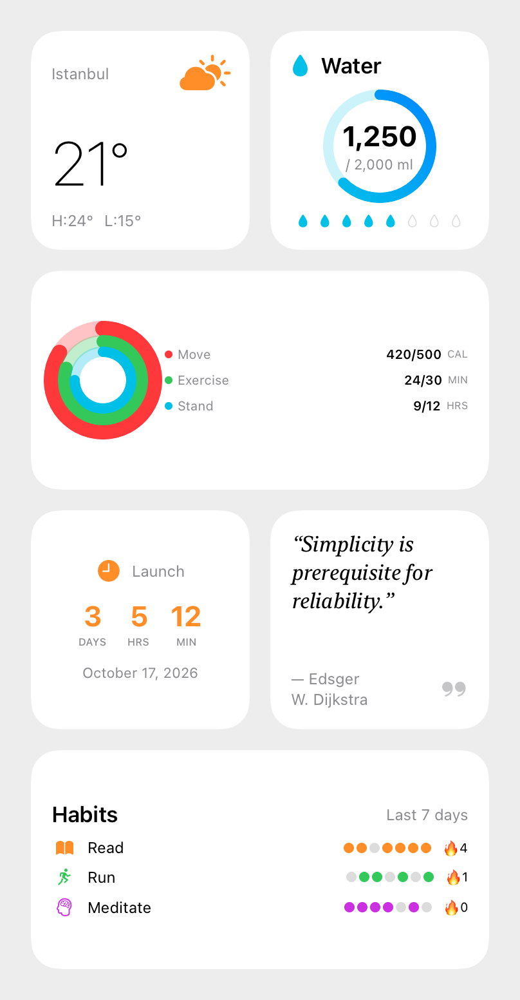
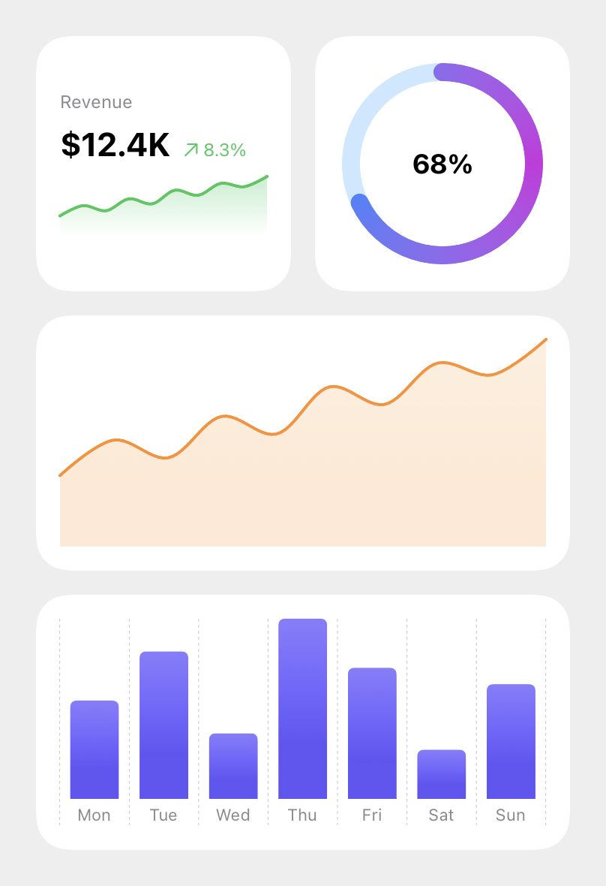
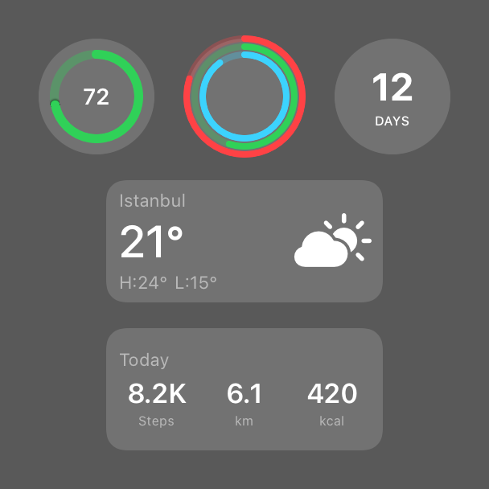

<!-- i18n-source: README.md@21d649e6f03399b9ae6f8c248f63c32d4a134aab status=reviewed -->
<!-- brand:start -->

<p align="center"><picture><source media="(prefers-color-scheme: dark)" srcset="https://raw.githubusercontent.com/muhittincamdali/iOS-Widget-Development-Kit/main/.github/brand/banner-ru-dark.svg"><source media="(prefers-color-scheme: light)" srcset="https://raw.githubusercontent.com/muhittincamdali/iOS-Widget-Development-Kit/main/.github/brand/banner-ru-light.svg"></picture></p>

<!-- lang-selector:start -->
<p align="center"><a href="README.md">English</a> · <a href="README.tr.md">Türkçe</a> · <a href="README.zh-CN.md">简体中文</a> · <a href="README.ja.md">日本語</a> · <a href="README.ko.md">한국어</a> · <a href="README.es.md">Español</a> · <a href="README.de.md">Deutsch</a> · <a href="README.fr.md">Français</a> · <a href="README.pt-BR.md">Português (Brasil)</a> · <a href="README.ru.md">Русский</a></p>
<!-- lang-selector:end -->

<p align="center">
<a href="https://github.com/muhittincamdali/iOS-Widget-Development-Kit/actions/workflows/ci.yml"></a>
<a href="https://github.com/muhittincamdali/iOS-Widget-Development-Kit/blob/main/Package.swift"><picture><source media="(prefers-color-scheme: dark)" srcset="https://raw.githubusercontent.com/muhittincamdali/iOS-Widget-Development-Kit/main/.github/brand/badge-platforms-dark.svg"><source media="(prefers-color-scheme: light)" srcset="https://raw.githubusercontent.com/muhittincamdali/iOS-Widget-Development-Kit/main/.github/brand/badge-platforms-light.svg"></picture></a>
<a href="https://github.com/muhittincamdali/iOS-Widget-Development-Kit/blob/main/Package.swift"><picture><source media="(prefers-color-scheme: dark)" srcset="https://raw.githubusercontent.com/muhittincamdali/iOS-Widget-Development-Kit/main/.github/brand/badge-language-dark.svg"><source media="(prefers-color-scheme: light)" srcset="https://raw.githubusercontent.com/muhittincamdali/iOS-Widget-Development-Kit/main/.github/brand/badge-language-light.svg"></picture></a>
<a href="https://github.com/muhittincamdali/iOS-Widget-Development-Kit/blob/main/LICENSE"><picture><source media="(prefers-color-scheme: dark)" srcset="https://raw.githubusercontent.com/muhittincamdali/iOS-Widget-Development-Kit/main/.github/brand/badge-license-dark.svg"><source media="(prefers-color-scheme: light)" srcset="https://raw.githubusercontent.com/muhittincamdali/iOS-Widget-Development-Kit/main/.github/brand/badge-license-light.svg"></picture></a>
</p>

<p align="center">
<a href="#быстрый-старт"><picture><source media="(prefers-color-scheme: dark)" srcset="https://raw.githubusercontent.com/muhittincamdali/iOS-Widget-Development-Kit/main/.github/brand/button-start-ru-dark.svg"><source media="(prefers-color-scheme: light)" srcset="https://raw.githubusercontent.com/muhittincamdali/iOS-Widget-Development-Kit/main/.github/brand/button-start-ru-light.svg"></picture></a>
<a href="https://muhittincamdali.github.io/iOS-Widget-Development-Kit/documentation/widgetdevelopmentkit/"><picture><source media="(prefers-color-scheme: dark)" srcset="https://raw.githubusercontent.com/muhittincamdali/iOS-Widget-Development-Kit/main/.github/brand/button-docs-ru-dark.svg"><source media="(prefers-color-scheme: light)" srcset="https://raw.githubusercontent.com/muhittincamdali/iOS-Widget-Development-Kit/main/.github/brand/button-docs-ru-light.svg"></picture></a>
<a href="https://github.com/muhittincamdali/iOS-Widget-Development-Kit/tree/main/Examples"><picture><source media="(prefers-color-scheme: dark)" srcset="https://raw.githubusercontent.com/muhittincamdali/iOS-Widget-Development-Kit/main/.github/brand/button-examples-ru-dark.svg"><source media="(prefers-color-scheme: light)" srcset="https://raw.githubusercontent.com/muhittincamdali/iOS-Widget-Development-Kit/main/.github/brand/button-examples-ru-light.svg"></picture></a>
</p>

> Это перевод README на английском языке. Если они расходятся, актуальна английская версия.

<!-- brand:end -->

WidgetDevelopmentKit — это Swift-пакет для разработчиков, которые создают виджеты для своих
iOS-приложений. В нём есть готовые SwiftUI-представления для виджетов экрана «Домой», экрана
блокировки и StandBy, представления графиков под размер виджета, вспомогательные типы для
таймлайнов и для данных, которые приложение передаёт виджету, App Intents для кнопок в
виджетах, а также атрибуты и представления ActivityKit для Live Activities. Расширение с
виджетами вы по-прежнему пишете сами; пакет избавляет от работы над представлениями и над
логикой дат, хранения и повторных попыток, которая нужна любому виджету.

## Основные возможности

- **20 шаблонов для экрана «Домой»** — погода, статистика, финансы, календарь, обратный
  отсчёт, часы, заметки, цитата, музыка, подкаст, новости, кольца активности, трекер
  привычек, список дел, вода, батарея и другие.
- **Экран блокировки и StandBy** — 15 представлений для аксессуарных семейств (круглые,
  прямоугольные, строчные) и 7 представлений для StandBy.
- **Помощники для таймлайнов** — даты записей, политики перезагрузки и хранилище снимков со
  сроком действия, чтобы виджет читал то, что приложение сохранило через App Group.
- **Интерактивные виджеты** — 5 App Intents и 8 представлений с кнопками, которые их
  запускают.
- **Live Activities** — 10 типов `ActivityAttributes` с представлениями для экрана блокировки
  и компактного Dynamic Island, а также конечный автомат, который отклоняет обновления,
  пришедшие не по порядку.
- **Протестированная логика** — код для дат, чисел и повторных попыток покрыт тестами Swift
  Testing, включая граничные случаи вроде `NaN`, нулевой цели и дней перехода на летнее время.

## Быстрый старт

**1. Добавьте пакет**

Приложению нужно расширение с виджетами. Если его ещё нет, выберите в Xcode **File › New ›
Target…** и затем **Widget Extension**. После этого выберите **File › Add Package
Dependencies…**, вставьте этот адрес в поле поиска в правом верхнем углу и нажмите **Add
Package**:

```text
https://github.com/muhittincamdali/iOS-Widget-Development-Kit.git
```

В следующем окне в столбце **Add to Target** для `WidgetDevelopmentKit` выберите расширение
с виджетами и нажмите **Add Package**.

**2. Импортируйте модуль**

В начале Swift-файла в расширении с виджетами:

```swift
import WidgetDevelopmentKit
```

**3. Используйте**

Добавьте этот виджет в расширение. Он показывает обратный отсчёт до даты с помощью
представления `CountdownWidget` из пакета. Затем добавьте `LaunchCountdownWidget()` в
`WidgetBundle` расширения — тип, помеченный `@main`.

```swift
struct LaunchEntry: TimelineEntry {
    let date: Date
}

struct LaunchProvider: TimelineProvider {
    func placeholder(in context: Context) -> LaunchEntry {
        LaunchEntry(date: .now)
    }

    func getSnapshot(in context: Context, completion: @escaping (LaunchEntry) -> Void) {
        completion(LaunchEntry(date: .now))
    }

    func getTimeline(in context: Context, completion: @escaping (Timeline<LaunchEntry>) -> Void) {
        // One entry per hour for the next six hours, then WidgetKit asks again.
        let entries = TimelineSchedule.dates(from: .now, every: 60 * 60, count: 6).map(LaunchEntry.init)
        completion(Timeline(entries: entries, policy: .atEnd))
    }
}

struct LaunchCountdownWidget: Widget {
    let launchDay = DateComponents(calendar: .current, year: 2027, month: 1, day: 1).date ?? .now

    var body: some WidgetConfiguration {
        StaticConfiguration(kind: "launch", provider: LaunchProvider()) { entry in
            CountdownWidget(title: "Launch", targetDate: launchDay, referenceDate: entry.date)
        }
        .configurationDisplayName("Countdown")
        .supportedFamilies([.systemSmall])
    }
}
```

Запустите приложение в симуляторе iPhone. На экране «Домой» нажмите и удерживайте пустое
место, коснитесь **Edit › Add Widget**, найдите своё приложение и добавьте **Countdown**. Тот
же код есть в
[`Examples/WidgetKitExample`](Examples/WidgetKitExample/Widgets/LaunchCountdownWidget.swift).

## Установка

### Swift Package Manager

В Xcode выберите **File › Add Package Dependencies…** и введите адрес репозитория:

```text
https://github.com/muhittincamdali/iOS-Widget-Development-Kit.git
```

Или добавьте его в `dependencies` вашего `Package.swift`:

```swift
dependencies: [
    .package(url: "https://github.com/muhittincamdali/iOS-Widget-Development-Kit.git", branch: "main")
],
targets: [
    .target(name: "YourApp", dependencies: [
        .product(name: "WidgetDevelopmentKit", package: "iOS-Widget-Development-Kit")
    ])
]
```

Единственный тег, `v1.0.0`, старше текущего кода и не собирается; до следующего релиза с тегом
используйте ветку `main`. У пакета нет сторонних зависимостей.

## Использование

Все примеры на Swift в этом разделе взяты из
[`Examples/WidgetKitExample`](Examples/WidgetKitExample), который собирает CI, или из
[`ReadmeExamplesTests.swift`](Tests/WidgetDevelopmentKitTests/ReadmeExamplesTests.swift),
который компилируется вместе с тестами. Если блок кода здесь перестанет совпадать с этим кодом,
тест упадёт.

### Чтение общих данных в провайдере таймлайна

`TimelineSchedule` создаёт даты записей, `TimelineBuilder` сортирует записи и превращает
`WidgetUpdatePolicy` в политику перезагрузки WidgetKit, а `WidgetSnapshotStore` читает то, что
приложение сохранило в общую App Group.

```swift
struct StepsProvider: TimelineProvider {
    let store = WidgetSnapshotStore(defaults: UserDefaults(suiteName: "group.com.example.widgets") ?? .standard)

    func placeholder(in context: Context) -> StepsEntry {
        StepsEntry(date: .now, steps: 6_000)
    }

    func getSnapshot(in context: Context, completion: @escaping (StepsEntry) -> Void) {
        completion(placeholder(in: context))
    }

    func getTimeline(in context: Context, completion: @escaping (Timeline<StepsEntry>) -> Void) {
        completion(makeTimeline(now: .now))
    }

    func makeTimeline(now: Date) -> Timeline<StepsEntry> {
        // Written by the app; stale data is better than an empty widget.
        let steps = store.staleValue(Int.self, forKey: "steps") ?? 0
        let entries = TimelineSchedule
            .dates(from: now, every: 15 * 60, count: 4)
            .map { StepsEntry(date: $0, steps: steps) }
        return TimelineBuilder(entries: entries)
            .reloading(.every(minutes: 60), from: now)
            .build()
    }
}
```

### Сохранение данных в приложении

Приложение записывает значение со сроком действия и просит WidgetKit перезагрузить виджет:

```swift
try store.save(steps, forKey: "steps", lifetime: 30 * 60)
WidgetCenter.shared.reloadTimelines(ofKind: "steps")
```

Добавьте приложению и расширению возможность **App Groups** с одним и тем же идентификатором.
Хранилище использует `UserDefaults`, которое не шифруется, поэтому не храните в нём секреты.

### Отображение записи

```swift
struct StepsWidgetView: View {
    let entry: StepsEntry

    var body: some View {
        WidgetProgressRing(progress: Double(entry.steps), total: 10_000, colors: [.green, .mint])
            .padding()
            .containerBackground(.fill.tertiary, for: .widget)
            .widgetURL(WidgetDeepLink(scheme: "steps", host: "today"))
    }
}
```

Представления, показывающие значения, которые зависят от времени (`CountdownWidget`,
`StandByCountdownWidget`, `LockScreenCountdownWidget`), принимают `referenceDate`; передавайте
`entry.date`, чтобы каждая запись показывала свой момент времени.

### Кнопка в виджете

```swift
struct WaterButton: View {
    var body: some View {
        Button(intent: IncrementIntent(counterId: "water", amount: 250)) {
            Label("+250 ml", systemImage: "drop.fill")
        }
    }
}
```

Интенты выполняются в расширении с виджетами и записывают данные в `WidgetStateStore.shared`.
Это хранилище использует App Group, указанную в ключе `WidgetDevelopmentKitAppGroup` в
Info.plist. Добавьте ключ и в приложение, и в расширение и зарегистрируйте интенты пакета:

```swift
struct AppIntentsRoot: AppIntentsPackage {
    static var includedPackages: [any AppIntentsPackage.Type] {
        [WidgetDevelopmentKitIntents.self]
    }
}
```

### Загрузка данных с сервера

```swift
struct RandomQuote: Decodable {
    let text: String
}

func loadQuote() async throws -> RandomQuote {
    guard let base = URL(string: "https://api.example.com") else { throw URLError(.badURL) }
    let endpoint = Endpoint(base: base)
        .appendingPath("v1/quotes/random")
        .adding(query: "lang", "en")
    guard let request = endpoint.request else { throw URLError(.badURL) }
    return try await WidgetDataLoader().load(RandomQuote.self, from: request)
}
```

`WidgetDataLoader` использует эфемерную сессию с короткими тайм-аутами, которая не ждёт
появления сети. Он повторяет запросы при ответах 5xx и 408, тайм-аутах и ошибках отсутствия
сети (по умолчанию один раз; изменить можно через `RetryPolicy`), но не при ответах 4xx и
ошибках декодирования.

## Демо

<picture>
  <source media="(prefers-color-scheme: dark)" srcset="docs/images/home-screen-dark.png">
  
</picture>
<picture>
  <source media="(prefers-color-scheme: dark)" srcset="docs/images/charts-dark.png">
  
</picture>

<picture>
  <source media="(prefers-color-scheme: dark)" srcset="docs/images/lock-screen-dark.png">
  
</picture>

Изображения отрисованы из представлений пакета с помощью `ImageRenderer` скриптом
[`scripts/render-screenshots.sh`](scripts/render-screenshots.sh). Поскольку они рисуются вне
WidgetKit, рамка виджета, эффект vibrancy на экране блокировки и ночной режим StandBy лишь
приблизительно повторяют то, что показывает система.

Чтобы попробовать виджеты самостоятельно, откройте
[`Examples/WidgetKitExample/WidgetKitExample.xcodeproj`](Examples/WidgetKitExample) и запустите
схему **WidgetKitExample** в симуляторе iPhone; в
[`Examples/README.md`](Examples/README.md) описаны три виджета и то, как добавить их на экран
«Домой».

## Документация

Справочник API и статьи:

- [Справочник API](https://muhittincamdali.github.io/iOS-Widget-Development-Kit/documentation/widgetdevelopmentkit/)
  на GitHub Pages, созданный из DocC-комментариев в исходном коде.
- В Xcode: **Product › Build Documentation** или
  `xcodebuild docbuild -scheme WidgetDevelopmentKit -destination 'generic/platform=iOS Simulator'`.

## Руководства

- [Getting Started](https://muhittincamdali.github.io/iOS-Widget-Development-Kit/documentation/widgetdevelopmentkit/gettingstarted):
  добавление расширения с виджетами и пакета, обмен данными через App Group, построение
  таймлайна и отрисовка записи.
- [Interactive Widgets](https://muhittincamdali.github.io/iOS-Widget-Development-Kit/documentation/widgetdevelopmentkit/interactivewidgets):
  настройка App Group, регистрация интентов, добавление кнопок и чтение их состояния в
  провайдере и в приложении.

## Требования

| Платформа   | Минимальная версия |
| ----------- | ------------------ |
| iOS         | 17.0               |
| macOS       | 14.0               |
| Инструменты | Swift 6.0          |

Представления для экрана блокировки и Live Activities есть только в iOS. Цель для macOS нужна,
чтобы платформенно-независимый код и его тесты запускались через `swift test`. CI собирает пакет
с Xcode, установленным по умолчанию в образе `macos-26` на GitHub; для локальной разработки используется
Xcode 27. Более старые версии Xcode не проверялись.

## Архитектура

```text
Sources/WidgetDevelopmentKit/
├── Core/            Pure helpers: clamping, formatting, month grid, countdown math
├── Timeline/        Update policy, timeline builder and schedule, snapshot store
├── Networking/      Data loader with retry policy, endpoint builder
├── Configuration/   Deep links, hex colors, App Intents entities
├── Interactive/     App Intents, shared state store, interactive views
├── Templates/       Home Screen views
├── Charts/          Swift Charts views
├── LockScreen/      Accessory family views (iOS)
├── StandBy/         StandBy views
├── LiveActivities/  ActivityKit attributes and views (iOS), state machine
├── UI/              Timeline scrubber
└── WidgetDevelopmentKit.docc/
```

Представления остаются тонкими: вычисления, которые могут сломаться на реальных данных
(нулевые цели, `NaN`, перевёрнутые диапазоны дат, дни перехода на летнее время), вынесены в
`Core` и `Timeline` как чистые функции с модульными тестами. Типы, которые работают с
хранилищем или сетью, получают зависимости (`UserDefaults`, часы, транспорт, ожидание) через
параметры, поэтому их можно тестировать без App Group и сервера. Для body SwiftUI-представлений
снапшот-тестов нет.

Запустите тесты на macOS и в симуляторе iOS:

```sh
swift test
xcodebuild test -scheme WidgetDevelopmentKit -destination 'platform=iOS Simulator,name=iPhone 17 Pro'
```

Три iOS-теста пропускаются намеренно: они отрисовывают изображения для README и запускаются
только через `scripts/render-screenshots.sh`.

## План развития

- Отметить тегом релиз, соответствующий текущему коду, чтобы пакет можно было подключать по
  версии.
- Снапшот-тесты для body представлений.
- Пример Live Activity в демонстрационном приложении.

В [CHANGELOG](CHANGELOG.md) записаны все изменения на сегодня, в том числе то, как пакет был
восстановлен в октябре 2026 года, после того как выяснилось, что код `v1.0.0` не собирается.

## Участие в разработке

Мы рады вашему участию. Перед открытием pull request прочитайте [руководство для участников](https://github.com/muhittincamdali/iOS-Widget-Development-Kit/blob/main/CONTRIBUTING.md) и [кодекс поведения](https://github.com/muhittincamdali/.github/blob/main/CODE_OF_CONDUCT.md). О проблемах безопасности сообщайте конфиденциально, как описано в [политике безопасности](https://github.com/muhittincamdali/.github/blob/main/SECURITY.md).

## Лицензия

Распространяется по лицензии MIT. Подробнее — в файле [LICENSE](LICENSE).
